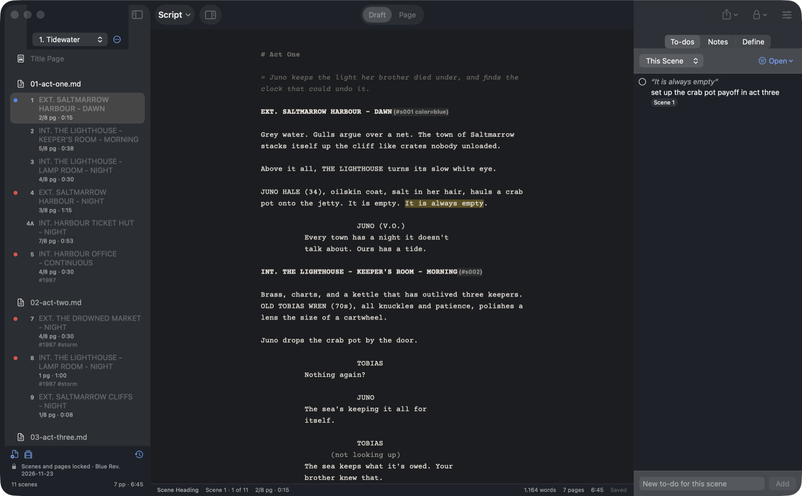
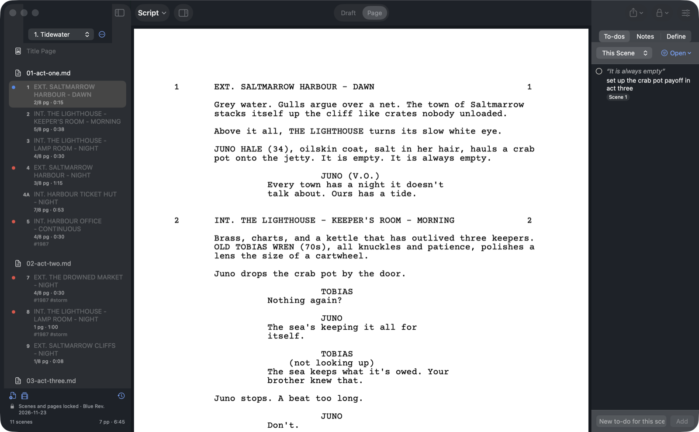
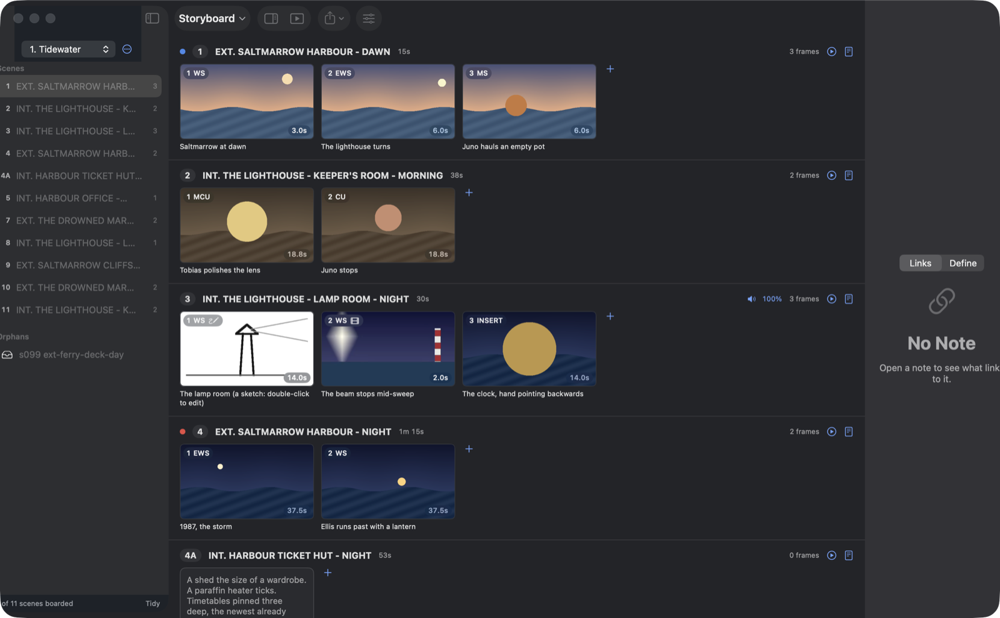
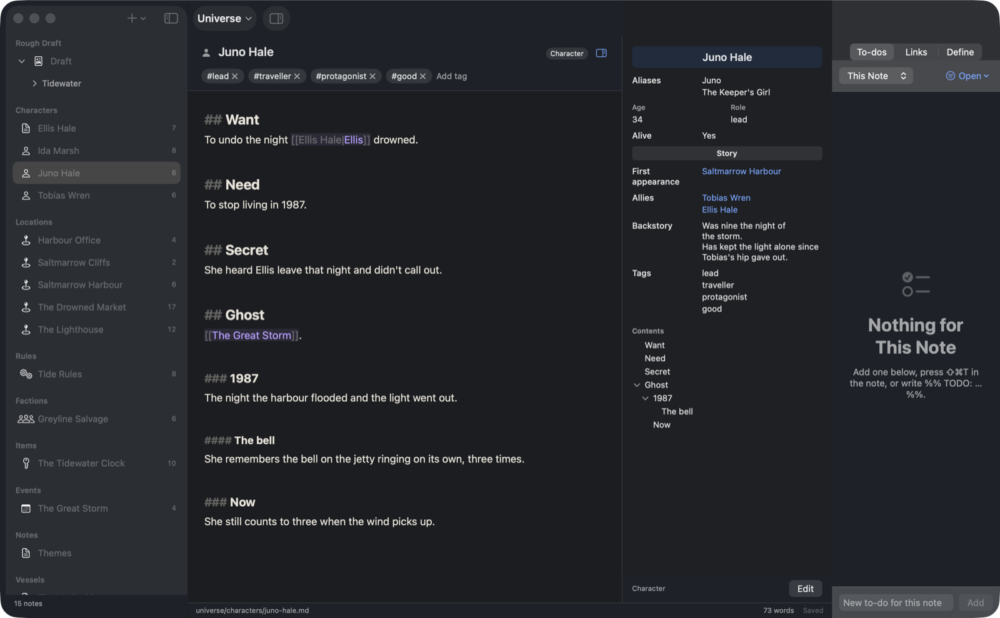
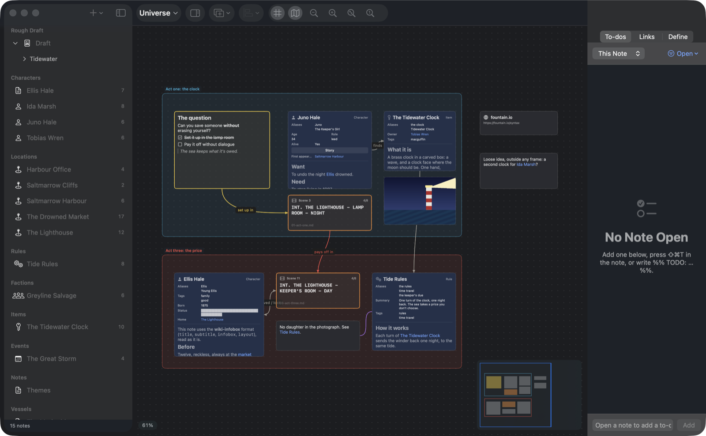
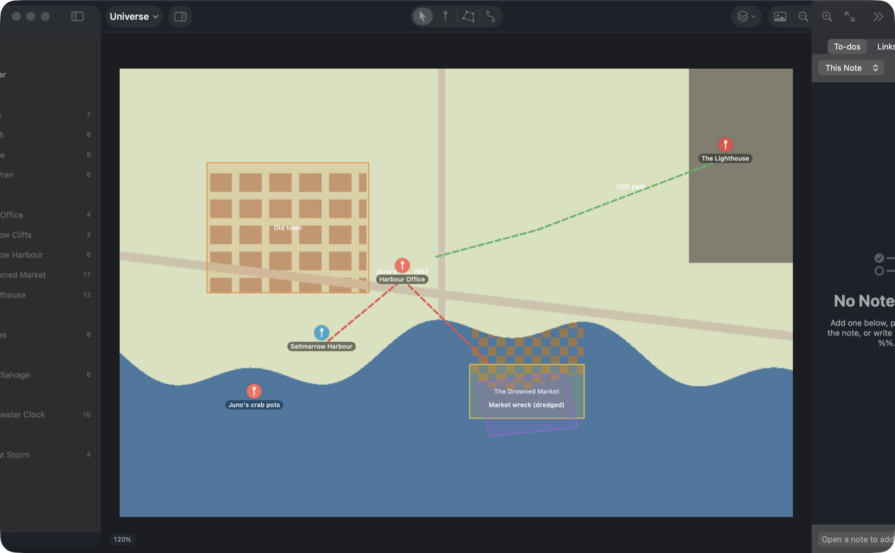
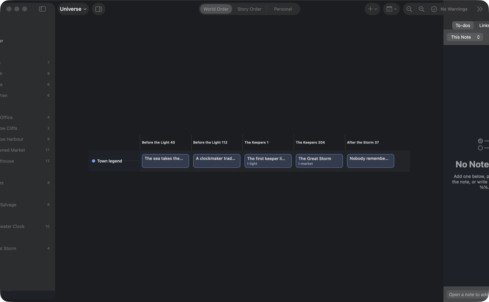
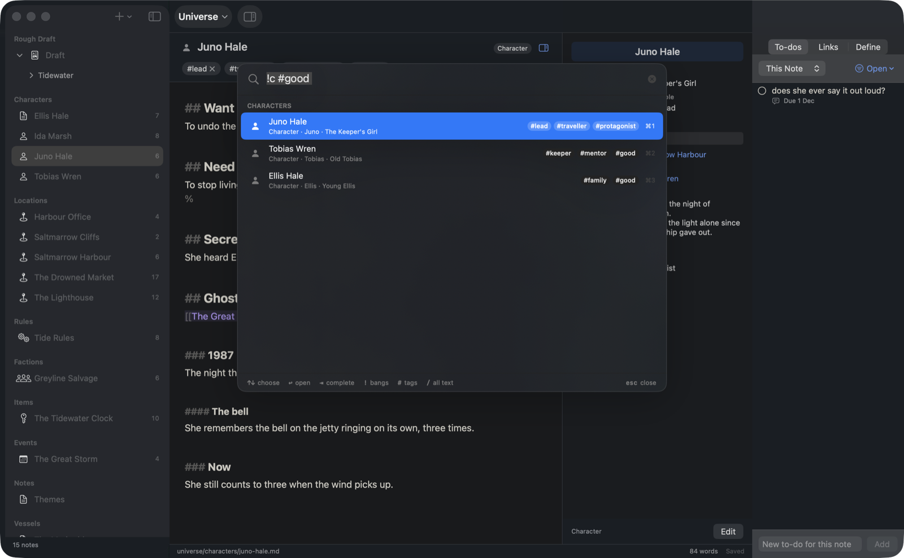
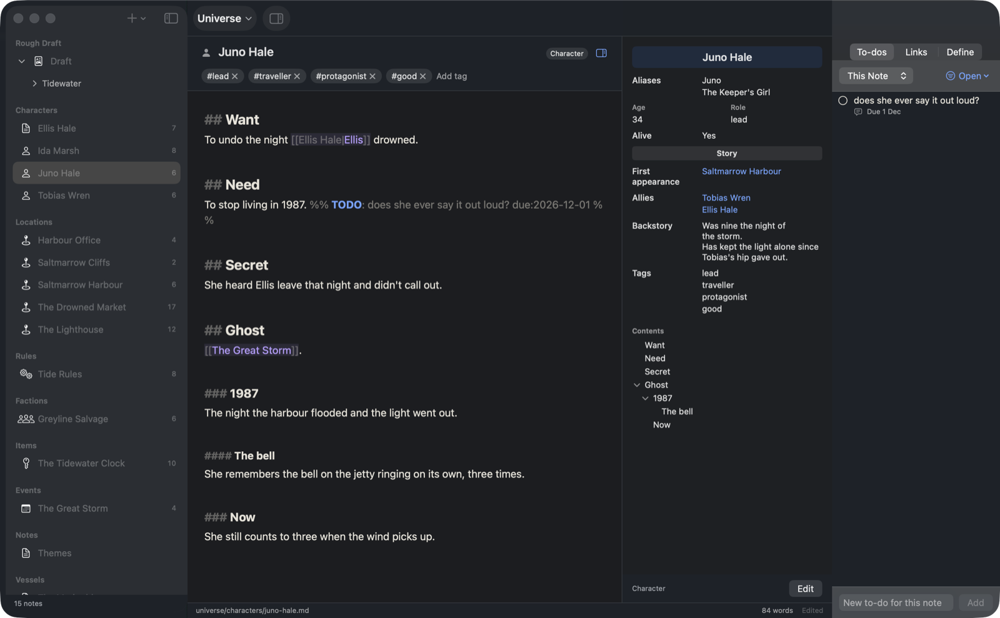

# Slate

A native macOS app for writing films. One project holds the world-building, the screenplay, the storyboard and a glossary, all as plain files in one folder. See [SPEC.md](SPEC.md) for the full design, [CHANGES.md](CHANGES.md) for what's built so far, and [DECISIONS.md](DECISIONS.md) for choices made along the way.

**Status: beta (0.9.0).** Every planned milestone is built; it's being tested by writers now. Download the newest build from [Releases](../../releases); Slate then keeps itself up to date.

| | |
| --- | --- |
|  |  |
| **Script:** Fountain with live formatting, scenes and timings, to-dos in the margin, several films per project. | **Page view:** exact pages, locked scene numbers and revisions. |
|  |  |
| **Storyboard:** frames per scene, sketches, and an animatic player. | **Universe:** typed notes with infoboxes, tags and a nested heading index. |
|  |  |
| **Canvas:** notes, scenes, images and links on a board. | **Maps:** pins, regions and paths linked to notes and scenes. |
|  |  |
| **Timelines:** world order, story order and time travel. | **Search (⌘K):** bangs like `!c` and `!s`, `#tags` and filters. |

The screenshots are of the showcase project, taken by `Scripts/screenshots.sh`.

## Requirements

- macOS 15 or later
- Xcode 16 or later (Swift 6)
- [XcodeGen](https://github.com/yonaskolb/XcodeGen): `brew install xcodegen`

Swift Package Manager fetches two dependencies the first time you build. Both are used only by SlateCore and pinned to exact versions in `Packages/SlateCore/Package.swift`:
- [Yams](https://github.com/jpsim/Yams) 6.2.2 (MIT) reads note frontmatter.
- Apple's [swift-markdown](https://github.com/swiftlang/swift-markdown) 0.9.0 (Apache 2.0, brings cmark-gfm) supplies note outlines and finds code blocks.

## Set up

The Xcode project isn't committed. Generate it from `project.yml`:

```sh
xcodegen generate
```

Run this again whenever you add or remove files, or change `project.yml`.

## Run

In Xcode:

```sh
open Slate.xcodeproj
```

Then pick the **Slate** scheme and press ⌘R.

From the terminal:

```sh
xcodebuild -project Slate.xcodeproj -scheme Slate -configuration Debug build
open ~/Library/Developer/Xcode/DerivedData/Slate-*/Build/Products/Debug/Slate.app
```

New projects go in `~/Documents/Slate` by default. The project library is stored in `~/Library/Application Support/Slate/`.

## Test

The fastest way to run the tests:

```sh
swift test --package-path Packages/SlateCore   # models, files, parser, editing rules
swift test --package-path Packages/SlateUI     # the script editor, driven by keystrokes
swift test --package-path Packages/SlateExport # PDF, Fountain, FDX, page breaks vs reference PDFs
```

The same tests can also run through the Xcode scheme, with ⌘U in Xcode or:

```sh
xcodebuild -project Slate.xcodeproj -scheme Slate -destination 'platform=macOS' test
```

Tests use Swift Testing and work on temp copies of the sample project in `Fixtures/SampleProject/`. The SlateUI tests type into the real editor without a window, and include a speed check (under 16 ms per keystroke on a 10-page script). The SlateExport tests compare Slate's page breaks with the reference PDFs in `Fixtures/Fountain/` and the layout with a snapshot in `Fixtures/Snapshots/`. If you change the layout on purpose, regenerate the snapshot with `SLATE_UPDATE_SNAPSHOTS=1 swift test --package-path Packages/SlateExport`.

## Try it by hand

1. Run Slate, click **New Project**, enter a title and choose a template.
2. Right-click the project's card and choose **Show in Finder**.
3. In the project window, open a file such as `script/title-page.md`.
4. Edit that file in TextEdit or VS Code and save it. Slate reloads it within a second.
5. Type in Slate, then edit the same file outside before Slate autosaves (it waits 2 s). A **Changed on disk** banner offers Keep Mine or Load Theirs.

## Home and the library

- **Welcome window** on launch (turn it off in its corner or Settings › General; Help › Welcome to Slate brings it back): open the sample film, start a project, or open a folder.
- **Cards or a list** (the toolbar switch). Cards show the cover, last edit, length (`12 pp · 11 min`) and open to-dos.
- **Right-click a project:** Open, Show in Finder, Pin, Rename…, Duplicate, Export as .zip…, Remove from Library (files stay), Move to Trash….
- **Pending** (in the sidebar, with a count) lists every open to-do in every project: margin to-dos and `TODO:` comments. Click one to open the project right there; click its circle to mark it done. Filter All / Overdue / Due This Week, or search.
- **Watched folders:** the + right after "Watched Folders" (or Settings › Library) adds a folder; Slate lists every project inside it. Right-click › Stop Watching.
- **Import…** (⇧⌘I or Home's Import button) takes a Slate project folder (added in place or copied), a project `.zip`, a screenplay (Fountain, Final Draft, text, Markdown), or a folder of Markdown notes such as an Obsidian vault, which becomes a project with its notes in `universe/` (links, canvases and attachments kept; `.obsidian` left out).

## Showcase project

**Easiest:** Home › New Project › Template: **Showcase (sample film)**, or Help › Open Sample Film. Slate copies *Tidewater*, a made-up short film that uses every feature built so far, into a new project under your title, ready to poke at. Make as many copies as you like; follow the `SHOWCASE.md` checklist inside.

The original lives in the repo at `Showcase/Tidewater` and is built into the app. Edit it there (not through a copy) to change what new copies get; `ShowcaseTests` keeps it valid, and it grows with each milestone. Opening the repo copy directly with ⌘O works too, but Slate then tidies folders and writes its cache inside it.

## Writing a script

Scripts are standard [Fountain](https://fountain.io/syntax) in `script/`. Act files (`01-act-one.md`, …) join in name order.

- A scene heading is a line starting with `INT.`, `EXT.`, `INT./EXT.`, `I/E` or `EST.` after a blank line. Any other heading is forced with a leading `.` (`.THE VAULT`). The editor adds or removes that `.` for you, and capitalises the heading, when you leave the line.
- `#`, `##`, … lines are Fountain sections (acts, sequences). They organise the script but never print.
- Each scene heading becomes a scene in the navigator and a row in the storyboard.
- **Colour labels:** right-click a scene in the navigator › Colour. The label is stored in the scene's tag (`{#s014 color=blue}`) and never prints.
- **Act files:** the navigator's New Act File button (or Script › New Act File) adds the next one. Drag a scene onto another act file (or right-click › Move to) to move it there.
- **Focus mode** (⇧⌘↩) hides the side columns and dims everything but the paragraph you're writing. **Typewriter scrolling** (View menu) keeps your line near the middle.
- **Snapshots:** ⇧⌘S saves a named copy of the script to `script/.snapshots/`. Script › Snapshots… lists them, compares any one with the script now, side by side, and restores it (saving today's script first).

### Sagas: several films in one project

A project can hold any number of films: a saga, a trilogy, a series. Script › Film › New Film… (or the film button under the navigator) adds one:

```text
script/
├── 01 Tidewater/            the first film: act files, title-page.md,
│   ├── 01-act-one.md        production.json, revisions/, .snapshots/
│   └── title-page.md
├── 02 Slack Water/          the second film, the same layout
└── margin/                  to-dos and notes, shared by every film
```

- The first New Film moves your existing script into `script/01 <project name>/`. It asks first.
- The film bar above the Script and Storyboard navigators switches films, and both areas follow. ⌃⌘] and ⌃⌘[ step through them.
- Each film has its own scene numbers, pages, production lock, revisions, snapshots and exports.
- Universe notes, the dictionary, to-dos, timelines, maps and the storyboard folder are shared. Scene IDs never repeat across films, so each storyboard row and to-do belongs to one scene.
- Films play in folder order. To reorder them, renumber the folders in Finder.

| Key | In the script editor |
| --- | --- |
| Return | Next element: Heading → Action, Action → Action, Character → Dialogue, Parenthetical → Dialogue, Dialogue → Action, Transition → Heading |
| Tab / ⇧Tab | Cycle the line: Action → Character → Transition → Scene Heading. Inside a speech: Dialogue ↔ Parenthetical |
| Tab or → | Accept the highlighted autocomplete (character names, `INT.`/`EXT.`, locations, `DAY`/`NIGHT`) |
| Esc | Dismiss the autocomplete |
| ⌥Return | Plain line break |

Scene IDs such as `{#s014}` are added when you finish typing a heading. They show as a small grey tag. They're Slate's one addition to Fountain: they keep each storyboard attached to its scene when you rename or move it. Fountain scene numbers (`#1A#`) are read too. Exports to Fountain, Final Draft and PDF leave the tags out.

## Publishing

- **Page view** (⇧⌘\\ or the Draft/Page switch) shows the script exactly as it will print. You edit in Draft view, and the pages catch up a moment after you stop typing.
- **Script › Publish** writes PDF (⇧⌘E), Final Draft (.fdx), Fountain or Markdown into the project's `exports/` folder, and also offers the animatic and boards PDF (see Animatic).
- **Print Script…** (⌥⌘P) uses the same renderer.
- **Publish settings** (the sliders button in the Script toolbar): page size, scene numbers, automatic (CONT'D), and bold/italic/underline. They're saved in `project.json`.
- **Import Screenplay…** (⇧⌘I, or Import on the home screen) makes a new project from a `.fountain`, `.fdx`, `.txt` or `.md` file. Fountain `# Sections` become act files.

Publish always uses Courier Prime 12 pt and the industry layout, whatever the editor theme. Courier Prime is bundled under the SIL Open Font License (`Packages/SlateExport/Sources/SlateExport/Resources/Fonts/OFL.txt`).

## Margin: to-dos and notes

- **The sidebar** on the right (⌥⌘0 or its toolbar button, beside the area title) holds the margin. In the script its tabs are **To-dos**, **Notes** and **Define**; in Universe, **To-dos**, **Links** and **Define**; elsewhere, Links and Define. ⇧⌘M jumps to To-dos. The script's To-dos and Notes each show **This Scene** (the caret's scene) or **All**.
- **⇧⌘T** adds a to-do at the caret and **⌥⌘T** adds a note. Each is anchored to the scene, and to the selected words if you selected some. Anchored words get a soft highlight in the script, and clicking the quote in the margin selects them.
- **Files:** to-dos are a Markdown task list in `script/margin/todos.md`, e.g. `- [ ] "I haven't opened it yet" — make it land @s014 due:2026-12-01`. Notes are list items under `## @s014` headings in `script/margin/notes.md`. Both read fine in any editor, and outside edits reload.
- **All to-dos:** set the To-dos tab to All, then filter (Open / Done / All) and order (By Scene / By Due Date) from its menu. Script › Show All To-dos jumps straight there.
- **Links:** hovering a `[[link]]` in the script or a note shows a preview. ⌘-click in the script, or a click in the margin, opens the note in the margin, so you never leave the scene.
- **TODO comments:** write a to-do where the work is, as a comment starting with `TODO:`. In the script: `/* TODO: tighten this exchange due:2026-12-01 */` (never printed). In a note or the draft: `%% TODO: check the 1987 dates %%` or `<!-- TODO: … -->`; ⇧⌘T in a note writes one at the caret. Right-click one › Mark To-do Done (or tick it in the margin or Pending) and it becomes `DONE:`. The margin lists the script's TODO comments too.
- **Notes have to-dos as well** (the sidebar's To-dos tab in Universe): their TODO comments for **This Note** or **All Notes**, with tick boxes, and a field that adds a new one to the open note.

  

- **Pending** in the library lists every open to-do; there's no launch sheet any more. **Settings › Reminders** turns due-date notifications (at 9:00) on or off.

## Universe notes

- **Notes** live in `universe/<type>/<name>.md`: YAML frontmatter for fields, then a Markdown body. Use + or ⌘N to make a note from a template: Character, Location, Rule, Faction, Item, Event or Freeform.
- **Templates** are `.md` files too. Make and edit them in **Universe › + › Edit Templates…**. Nothing is fixed: Slate's starting templates (Character, Location, Rule, Faction, Item, Event, Freeform) can be changed, renamed or deleted like your own.
  - **Editing** any template saves your version in the project's `templates/` folder, or in `~/Library/Application Support/Slate/Templates/` when "Saved in" is Every project. **Revert to Built-in** brings Slate's version back.
  - **Delete Template** works on every template. Deleting a built-in leaves a small `removed: true` file in `templates/` (or the global folder). The list's **Deleted** section restores it, and so does deleting that file. Notes made from a deleted template keep all their fields.
  - **Fields:** any field can be renamed, retyped or removed. Pick any text field as the note's **Name field**.
  - **Renaming a type** (say `character` → `person`) also rewrites `type:` in every note made from it.
  - The sample project overrides Character.
- **The wiki page:** a note opens with its body on the left and an infobox on the right. **Edit** turns the infobox into a form with these field types: text, long text, number, date, choice, yes/no, list, link, links and image. Each change rewrites only that field's lines, so comments and key order in the file stay as you wrote them.
- **Obsidian infobox notes** work as they are: `infobox: Character` picks the template, `title:` is the name, `subtitle:` sits under it, and a `layout:` list adds section headers (`type: header`, `above: key`) and columns (`type: columns`, `keys: [...]`). `||text||` is a spoiler, hidden until clicked.
- **Links:** typing `[[` suggests notes by name or alias, and ⌥⌘K inserts a link. ⌘-click a link to open it; clicking an unresolved link (red, dashed) offers to create the note. Links work in the script too.
- **Links** (the sidebar's Links tab, ⌥⌘0) lists backlinks from notes, scenes, margin notes and the rough draft. For a character it also lists the scenes they speak in.
- **Renaming** a note (press Return in its name, or right-click › Rename…) offers to update every link to it, and renames the file. Its `id` stays the same.
- **Contents (heading index):** under a note's infobox, on the fields side, **Contents** lists the note's headings as a nested tree: H2 › H3 › H4…. Click a heading to jump to it; a triangle folds its children (⌥-click: every level); right-click › Expand All / Collapse All. The sidebar lists notes only. The draft keeps its outline in the sidebar.
- **Rough draft:** `universe/draft.md` shows its headings in the sidebar. Right-click a heading › Turn into Scene to append it to the script. It's optional: right-click Draft › Move to Trash, and + › New Rough Draft makes a fresh one.
- **Voice notes:** File › Import Voice Note… (or + › Import Voice Note…) transcribes recordings into Freeform Notes tagged `voice-note`. See [Voice](#voice).
- **Tags:** type them under a note's name (Return or comma adds one, × removes it), or right-click a scene in the Script navigator › Tags…. Notes keep them in `tags:`, scenes in their hidden tag (`{#s014 tags=storm,flashback}`, never printed). The Universe sidebar's **Tags** section lists every tag; right-click one to rename it or remove it everywhere.

## Search (⌘K)

One search for everything in the project. Type a name, or start with a **bang** to search one part. `!` on its own lists them all.

| Bang | Searches |
| --- | --- |
| `!c` `!l` `!r` `!f` `!i` `!e` `!n` | Characters, locations, rules, factions, items, events, freeform notes (one per template; set in Edit Templates) |
| `!u` | Every universe note |
| `!s` | Scenes in every film. Filters: `time:night`, `place:harbour`, `int:`, `ext:`, `color:red`, `film:2`, `long:` |
| `!film` | Films; `!film slack !s` searches one film's scenes |
| `!cue` | What a character says: `!cue juno`, `!cue juno tide` |
| `!act`, `!x` | Act files and sections; transitions, centred text and boneyard notes |
| `!b` | Storyboard frames. `shot:CU`, `move:pan`, `empty:` for scenes with no frames |
| `!todo`, `!mn` | To-dos (`due:` soonest first, `done:` finished ones) and margin notes |
| `!tl`, `!m`, `!cv`, `!d` | Timeline events, map places, canvases, rough-draft headings |
| `!w` | Dictionary words |
| `!t` | Tags: `!t good protagonist` finds everything tagged both |
| `!file` | Any file |
| `!text` or `/` | Every line of text that matches; `"quotes"` for exact words (⇧⌘F opens Search like this) |

- `#tag` anywhere narrows to things with that tag: `!c #good`.
- `key:value` filters on any note field: `!c role:lead`.
- ↑/↓ choose, Return opens (switching area and film), ⌘Return opens and keeps Search open, ⌘1–⌘9 jump, Tab completes a bang or tag, Esc closes.
- **Settings › Search** changes the shortcut (⌘K by default) and renames area bangs. Template bangs are set per template.

## Canvas

- **Boards** are `universe/canvases/*.canvas` files in the open [JSON Canvas](https://jsoncanvas.org) format, so they open in Obsidian too. Use **New Canvas** in the sidebar's Canvases section or the + menu.
- **Cards:** text (Markdown), notes (live infobox), scenes, images, web links and frames. Drag notes, draft headings and scenes in from the sidebars, or images from Finder.
- **Moving around:** scroll to pan; pinch or ⌘-scroll to zoom; ⌥-drag to pan with a mouse. ⌘0 fits everything, ⇧⌘0 is 100%, and the minimap moves the view.
- **Editing:** drag to move (frames carry their cards), resize from the corner, and double-click to edit or open a card. Drag a side dot onto another card to connect them, then click the connection to label or colour it. **Arrange** aligns and distributes; **Snap to Grid** uses a 20 pt grid. Everything undoes.

## Timelines

- **Timelines** are `universe/timelines/*.timeline.json`. Use **New Timeline** in the sidebar or the + menu; the sample project has `main`.
- **Lanes** are characters or story threads (Add › Add Lane for Character links one to its note). **Events** have a world time, an optional end (a span), a lane, a place, the scenes that show them, and the events that cause them. Double-click a row to add an event at that time.
- **Three views:** **World Order** (when things happen), **Story Order** (as the film shows them, from scene order) and **Personal** (one character's life, following their jumps).
- **Jumps:** right-click an event › Jump From Here…, then click where the traveller arrives. **Branches:** Branch From Here starts an alternate line; set where it rejoins in its inspector.
- **Warnings** (toolbar) flag a character in two places at once with no jump, an event before its cause, events that fall between a traveller's jumps, unreadable times and broken links.
- **Time units:** dates (`2031-03-14T22:10`), days (`Day 3 14:00`), or a custom calendar of eras (`Second Age 312`).

## Maps

- **Maps** are `universe/maps/*.map.json` next to their image. **New Map** starts as a blank grid; add an image with the toolbar or drop one from Finder.
- **Tools:** Select, Pin, Region (click corners, double-click or Return to finish) and Path. Drag items to move them and the corner dots to reshape. Drop a note from the sidebar to pin it.
- **Links:** each item can link to a note (usually a location) and to scenes. Double-click an item to open its note or scene.
- **Layers** (toolbar) can be shown and hidden, and new items go on the layer you choose. Coordinates are saved from 0 to 1 across the image, so a sharper copy of the same image keeps every pin in place.
- **Show on Map:** right-click a scene in the Script sidebar to jump to the pin linked to that scene, or to the location its heading names.

## Storyboard

- **Every scene is a row,** in script order, with its number, heading, estimated time and frames. Empty scenes show their first action line.
- **Add frames:** drop images or clips from Finder onto a row, use its + menu (Add Images or Clips…, New Sketch, Paste), or ⌘V. Files are copied into `storyboard/scenes/<id> <slug>/`.
- **Arrange:** drag frames to reorder, or onto another scene. Delete sends a frame to the Trash.
- **Inspector:** shot size, camera move, lens, duration (empty = shares the scene's time), caption, the script lines it covers, and in/out for clips.
- **Script ↔ frames:** selecting a frame tints its lines in the script; frames covering the script caret are outlined. Right-click in the script › Show Frames in Storyboard.
- **Sketch pad (⇧⌘K):** pen with pressure, eraser, four greys, three sizes, 16:9 / 2.39:1 / 1.85:1 guides. Saved as a PNG with its strokes; double-click to edit.
- **Missing scenes:** a board whose scene was deleted is marked, with Reattach and Move to Orphans; on close it moves to `storyboard/orphans/`.

## Production

The Production menu (Script toolbar, or Script › Production) turns a draft into a shooting script. Everything it records is in `script/production.json` and `script/revisions/`.

- **Lock Scene Numbers:** numbers stop changing. A scene added later takes a letter from the one before it (`14A`, `14B`; `A1` before scene 1); a locked scene that's cut prints as `14  OMITTED`. Locked numbers also go into Fountain (`#14A#`) and Final Draft exports, the storyboard and the animatic.
- **Lock Pages:** each page keeps starting where it did. Text that no longer fits goes onto A-pages (`23A`); a page whose content was all cut prints as OMITTED.
- **Start Revision:** copies the script as it is now into `script/revisions/NN colour/`. Every change after that gets a `*` in the right margin, and changed pages carry the colour and date in their header (`Blue Rev. (11/23/26)`). Colours go White, Blue, Pink, Yellow, Green, Goldenrod, Buff, Salmon, Cherry.
- **Reports:** scene list (number, INT/EXT, location, time, length in eighths, page, cast), character report and location report, each as PDF or CSV.
- **Sides…:** choose scenes; you get just the pages they're on, with everything else crossed out.

## Animatic

- **Watch** (⌥⌘↩, the toolbar's Watch, or Storyboard › Watch Animatic) opens the player in its own window. Play the whole film, one scene (a row's ▶ button or + menu › Watch Scene), a range of scenes (the range menu), or from a frame to the end (right-click a frame › Play From Here).
- **Keys:** Space plays and pauses; ← / → step frames; ⌥← / ⌥→ step scenes; ⌃⌘F or a double-click goes full screen.
- **Timing:** frames without a duration share their scene's estimated time; clips play from In to Out; stills can slowly push in (Storyboard Settings) or follow a frame's "push in" / "pull out" move.
- **Overlays** (the player's Overlays menu): scene number and heading, caption, and subtitles. A line of dialogue shows during the frame whose Covers includes it; other lines are placed where they fall in the scene.
- **Sound:** a row's + menu › Add Scratch Audio… copies a recording into the scene's folder (named in `frames.json` as `"audio"`). Storyboard Settings › Temp Score adds a project-wide track in `storyboard/` (named in `storyboard.json`). Each has a volume.
- **Export** (toolbar Export menu, Storyboard menu, or Script › Publish): the animatic as an H.264 `.mov` with the overlays burned in, or a boards PDF with 2, 4 or 6 frames per page. Both go to `exports/`.

## Dictionary

- **One book:** `dictionary/words.md` is the film's own dictionary, filed A–Z under `## Letter` headings:
  ```markdown
  ## C

  - **Chronoshift** *noun* (chronoshifts, chronoshifted) — A jump between loops that keeps memory.
  - Calloway
  - **Copper Gate** — See [[The Copper Gate]].
  ```
  A word on its own is just a correct spelling. Anything after the dash is its meaning, and a `[[link]]` points to the Universe note with the full story.
- **The Dictionary area** reads it like a book. Search words, forms and meanings; jump with the A–Z strip; open a word to see its page and every place it's used in the script and notes. ⌘N or + adds a word. The toolbar's document button shows `words.md` as text.
- **Everywhere you write,** defined words get a faint dotted underline. Hovering one shows its meaning (or the linked note's preview), and ⌘-click opens it.
- **Spell check** accepts every word and form in the book, plus character names. Right-click a misspelling for **Add to Project Dictionary**, **Add to Every Project** (`~/Library/Application Support/Slate/words.md`) or **Define in Dictionary…**.
- **Define** (⌃⌥⌘D, or the sidebar's Define tab) shows the selected word's project meaning, then the Mac's dictionary definition. Force-click still opens Look Up.
- **Settings › Spelling** sets the language, grammar checking for the script and for notes, and auto-correct (off by default).
- Projects from before Milestone 6 are converted once: `words.txt` becomes entries, and any `dictionary/terms/*.md` file moves to `universe/notes/` with an entry linking to it. The originals are backed up in `.slate/backups/`.

## Layout

```
project.yml             XcodeGen project definition
App/                    App entry point (SlateApp.swift)
Packages/
  SlateCore/            Models, file I/O, watcher, themes. No UI. Unit-tested.
  SlateUI/              SwiftUI and AppKit views
  SlateExport/          PDF renderer, Fountain/FDX/Markdown import and export, animatic (AVFoundation) and boards PDF, Courier Prime
Fixtures/SampleProject  Sample project used by tests
Fixtures/MarkdownVault  A small Obsidian-style vault for the import tests
Scripts/                make-icon.swift (app icon), release.sh (signing and notarization)
Fixtures/Fountain       Reference scripts and PDFs from fountain.io
Fixtures/Snapshots      Golden page layouts
```

## Moving around

- **Areas:** click the title at the top of a project window (**Universe ▾**) to switch between Universe, Script, Storyboard and Dictionary, or press ⌘1–⌘4. Each area's sidebar holds its notes, scenes, boards or words.

## Voice

- **Dictate (⇧⌘D)** in the script, a note, the draft or the dictionary book. A panel at the cursor shows the level (and, with Apple, the words as you speak). Press ⇧⌘D again or Insert to put the text in; Esc cancels. It's one undo step.
- **Import Voice Note…** (File menu, or Universe › +) turns each recording (m4a, mp3, wav, aiff…) into a Freeform Note named after its first sentence, tagged `voice-note`, with `recording:` naming the file.
- **Settings › Voice** picks who transcribes:
  - **Apple** (default, recommended): on this Mac, offline, nothing to download. If macOS says the language isn't available offline, turn on Dictation in System Settings › Keyboard once.
  - **Whisper:** on this Mac with whisper.cpp. It's optional and not part of Slate: click **Download** next to "Whisper engine" (4 MB), then download a model (Base 142 MB, Small 466 MB, Large Turbo 547 MB). **Remove** takes it away again.
  - **OpenAI:** online; paste an API key (kept in your keychain). Up to 25 MB per recording.
- macOS asks for microphone and speech recognition permission the first time.

## Keyboard shortcuts

Every menu shortcut can be changed in **Settings › Shortcuts**: click one, press the new keys. Clashes with another command or macOS are refused. Reset puts one back; Reset All puts them all back.

| Shortcut | Action |
| --- | --- |
| ⌘N | New Note (in a project window; Add Word in the Dictionary) / New Project (elsewhere) |
| ⌥⌘N | New Project (from a project window) |
| ⌘K | Search |
| ⇧⌘D | Dictate at the cursor |
| ⇧⌘F | Search all text |
| ⌥⌘K | Insert link |
| ⌥⌘0 | Show / hide the sidebar (to-dos, notes, links, define) |
| ⌃⌥⌘D | Define the selected word |
| ⌘0 / ⇧⌘0 | Canvas: fit everything / 100% |
| ⌘= / ⌘− | Canvas and map: zoom in / out. Timeline: wider / narrower |
| ⌘0 | Map: fit |
| ⇧⌘K | New sketch (storyboard) |
| ⇧⌘S | Save a snapshot of the script |
| ⇧⌘↩ | Focus mode |
| ⌘A, ⌘-click | Storyboard: select every frame in a row, or add one to the selection |
| ⌥⌘↩ | Watch the animatic |
| Space, ← / →, ⌥← / ⌥→ | Player: play/pause, previous/next frame, previous/next scene |
| ⇧⌘T | Add to-do at the caret (script: margin to-do; note: `%% TODO:  %%` comment) |
| ⌥⌘T | Add margin note at the caret |
| ⇧⌘M | Sidebar on To-dos (again to hide it) |
| ⌘O | Open a project folder |
| ⇧⌘L | Project Library |
| ⌘S | Save |
| ⌘1 – ⌘4 | Universe, Script, Storyboard, Dictionary |
| ⇧⌘O | Jump to scene |
| ⌃⌘↑ / ⌃⌘↓ | Move the current scene up / down |
| ⌃⌘] / ⌃⌘[ | Next / previous film (in a saga) |
| ⇧⌘\\ | Draft / Page view |
| ⇧⌘E | Publish PDF |
| ⌥⌘P | Print script |
| ⇧⌘I | Import a project, .zip, screenplay or Markdown folder |
| ⌘, | Settings (appearance, spelling, reminders, voice, shortcuts) |

## Themes and settings

- **Settings › General:** the welcome window. **Appearance:** Light, Dark or Follow System, a theme for each, and text size (85–150%; Publish always prints at 12 pt). **Spelling:** language, auto-correct, and spelling and grammar switches for the script, notes, canvas cards and margin sheets. **Reminders.** **Library:** watched folders. **Search:** bangs. **Voice:** transcription engine, language, Whisper models, OpenAI key. **Shortcuts:** every menu shortcut, remappable.
- **Built-in themes:** Light and Dark (defaults), **Manuscript** (warm paper, Courier everywhere, like a typed book) and **Midnight** (near-black, softer text). Pick them in Settings › Appearance, as the light or dark theme, or per project in View › Theme for This Project.
- **Edit Themes…** (Settings › Appearance) opens the theme editor: duplicate a theme, change any colour, font or size with a live preview, and Reset a token to its base. Themes are `.slatetheme` JSON files in `~/Library/Application Support/Slate/Themes/` that store only what differs from their base; Import and Export share them.
- **View › Theme for This Project** overrides the theme for one project (saved in `project.json`).

## Distribution

Slate ships outside the Mac App Store as a Developer ID app, unsandboxed, with the hardened runtime.

- **Beta releases are automatic.** Every push to `main` runs `.github/workflows/release.yml` on GitHub's Macs: it runs the tests, builds with `Scripts/release.sh --adhoc` and publishes a prerelease `v0.9.0-beta.<run number>` with `Slate-0.9.0-beta.<n>.zip`. Day-to-day work happens on the `dev` branch, so nothing is released until `dev` is merged into `main`. The marketing version lives in `VERSION`.
- **Updates:** at launch Slate asks GitHub (`SlateUpdateRepository` in `project.yml`, `owner/repo`) for a newer release, downloads it in the background and shows **Restart to Update**: open projects are saved, Slate quits, swaps itself for the new copy and reopens. Slate › Check for Updates… checks on demand; Settings › General turns checking, automatic downloads and betas on or off. The repository's releases must be public for this to work.
- **Screenshots:** `Scripts/screenshots.sh` builds a Debug copy under its own bundle ID, runs a tour of the showcase and captures each step into `docs/screenshots/` (your terminal needs Screen Recording permission).

- **Test the packaging without an Apple account:** `Scripts/release.sh --adhoc` makes a Release build, signs it ad hoc and writes `build/release/Slate-<version>.zip`.
- **Developer ID signing and notarization** (no "can't verify" warning). One-time setup:
  1. **Certificate:** Xcode › Settings › Accounts › your team › Manage Certificates › + › **Developer ID Application**. Only the account holder can make one. Then, in Keychain Access, right-click that certificate › Export… as a `.p12` with a password.
  2. **API key:** App Store Connect › Users and Access › Integrations › App Store Connect API › Team Keys › + (Developer access). Download the `AuthKey_….p8` and note the Key ID and Issuer ID.
  3. **Run `Scripts/setup-signing.sh`.** It saves a `slate-notary` profile on this Mac, checks that Apple accepts it, and stores the certificate and key as encrypted secrets on the GitHub repo. It never prints a secret.

  From then on, every release from `main` is Developer ID signed and notarized. Without the secrets the workflow falls back to ad-hoc signing. To build a signed copy locally: `TEAM_ID=… NOTARY_PROFILE=slate-notary Scripts/release.sh`. A signed Slate only installs updates signed by the same team.
- **App icon:** `swift Scripts/make-icon.swift` redraws `App/Assets.xcassets/AppIcon.appiconset` from code.

## License

Slate © 2026 Tomás Martinez, licensed under [Creative Commons Attribution-NonCommercial-ShareAlike 4.0](https://creativecommons.org/licenses/by-nc-sa/4.0/) (CC BY-NC-SA 4.0). Full text: [LICENSE](LICENSE).

In short, you may use, copy and change Slate as long as you:

- **credit it:** name Slate and its author, link to this repository and the license, and say what you changed;
- **don't use it commercially:** no selling it, charging for a copy or a modified version, or using it in a paid product or service;
- **share alike:** anything you build from Slate must be released under this same license, source included.

Parts made by others keep their own licenses (whisper.cpp, Yams, swift-markdown, swift-cmark, Courier Prime): see [THIRD_PARTY_NOTICES.md](THIRD_PARTY_NOTICES.md). As the copyright holder, the author can still publish Slate elsewhere, including the Mac App Store.
